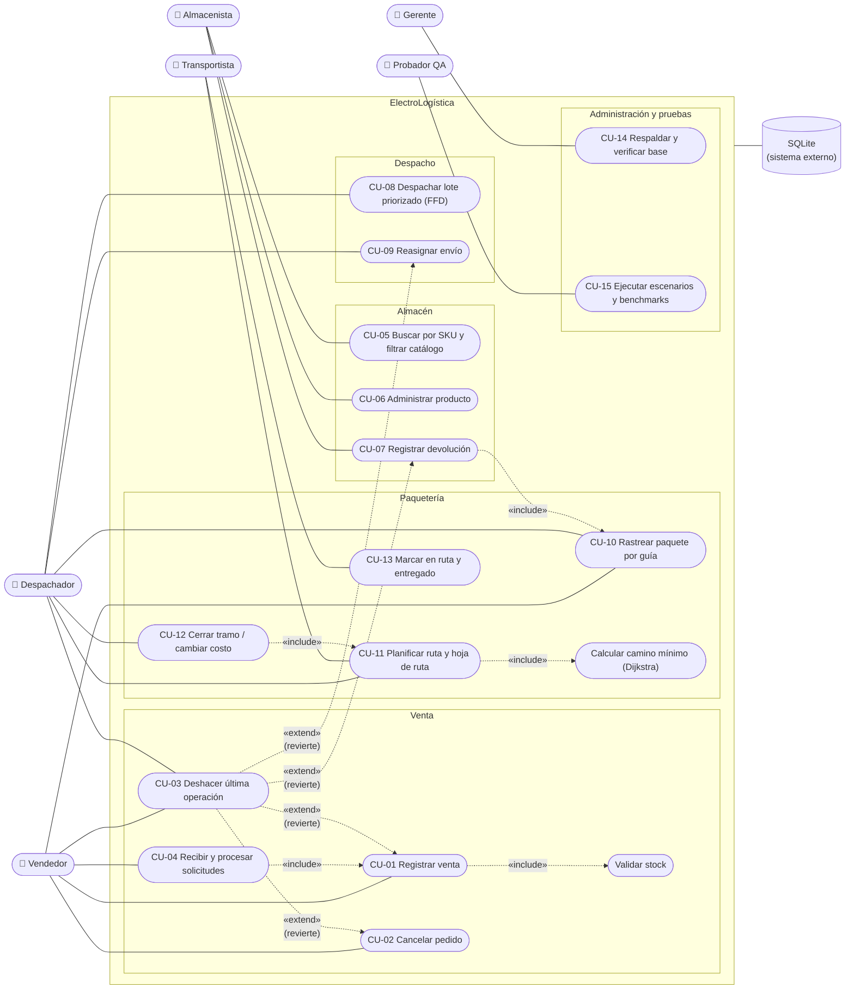

<!-- Ruta: docs/diagramas/casos_uso.md · Responsable: B (Bárbara Sofía Pérez Romo) · Fase 1 -->

# Diagrama de casos de uso – ElectroLogística

Mermaid no tiene un diagrama UML de casos de uso nativo. Se representa con un diagrama de flujo que sigue la notación UML: los actores van fuera del límite del sistema, los casos de uso son óvalos dentro del recuadro `ElectroLogística`, y las relaciones `«include»` y `«extend»` van punteadas y etiquetadas. Los identificadores coinciden con la Tabla 16 del reporte.

## Notas de lectura

- **CU-01 «include» Validar stock:** toda venta valida existencias dentro de la misma transacción (RI-01).
- **CU-04 «include» CU-01:** procesar el buffer de recepción registra cada solicitud como venta.
- **CU-03 «extend»:** deshacer amplía venta, cancelación, devolución y reasignación con su operación inversa, persistida en `bitacora_operaciones`.
- **CU-11 «include» Calcular camino mínimo:** la planificación encadena Dijkstra con la heurística del vecino más cercano.
- **CU-12 «include» CU-11:** el ruteo dinámico vuelve a planificar únicamente las rutas afectadas.
- **CU-07 «include» CU-10:** la devolución localiza el pedido por número de guía en el ABB.
