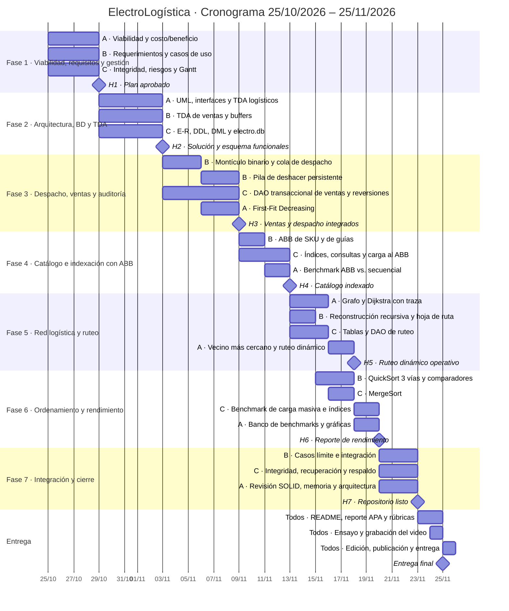

<!-- Ruta: docs/diagramas/gantt.md · Responsable: C (José Luis García Robinson) · Fase 1 -->

# Cronograma de Gantt – ElectroLogística

Periodo: **25/10/2026 – 25/11/2026**. Siete fases con sus dependencias (`after`) e hitos H1–H7. La tabla de fechas y la ruta crítica están en la sección «Cronograma» del reporte (`docs/reporte/12_integridad_riesgos_gantt.md`). Este diagrama es la fuente; el reporte lo replica.

## Carga por integrante (horas estimadas, Tabla 4 del reporte)

| Integrante | F1 | F2 | F3 | F4 | F5 | F6 | F7 | Total |
|---|---:|---:|---:|---:|---:|---:|---:|---:|
| A · Stephanny Elizabeth Torres Romo | 16 | 18 | 14 | 12 | 26 | 18 | 16 | 120 |
| B · Bárbara Sofía Pérez Romo | 16 | 18 | 22 | 20 | 10 | 12 | 18 | 116 |
| C · José Luis García Robinson | 16 | 20 | 22 | 14 | 12 | 16 | 18 | 118 |
