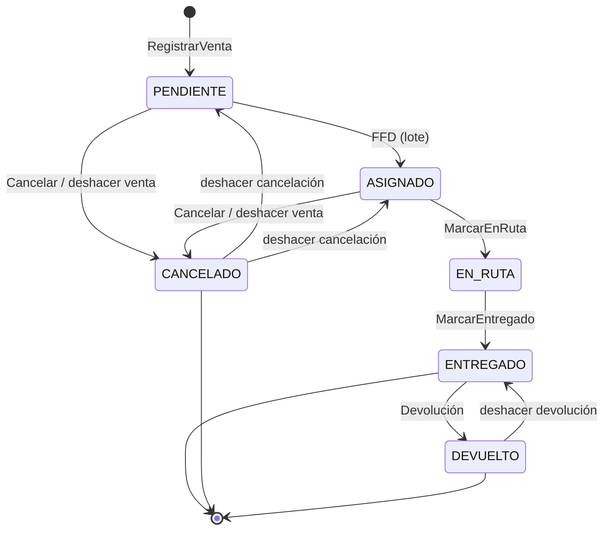
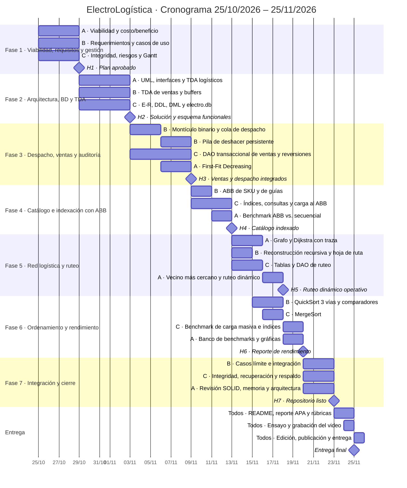

<!-- Ruta: docs/reporte/12_integridad_riesgos_gantt.md · Responsable: C (José Luis García Robinson) · Fase 1 -->

## Especificación de datos: reglas de integridad

Las reglas se aplican en tres niveles, del más fuerte al más débil: (1) **restricciones de SQLite** (PK, FK, CHECK e índices únicos), que ninguna aplicación puede saltarse; (2) **transacciones de los DAO**, para reglas que involucran varias filas o tablas; (3) **validación en el dominio**, para dar mensajes claros antes de llegar a la base. Toda regla tiene al menos una protección de nivel 1 o 2 (Tabla 18). Los nombres de las restricciones son los del contrato técnico.

**Tabla 18**  
*Reglas de integridad y su mecanismo de cumplimiento*

| ID | Regla | Nivel 1: SQLite | Nivel 2/3: DAO y dominio |
|---|---|---|---|
| RI-01 | **Stock no negativo** en cada almacén | `ck_inventario_stock` (stock >= 0) | `IInventarioDao.Descontar` hace `UPDATE … SET stock = stock - @c WHERE … AND stock >= @c` y, si no se afecta ninguna fila, lanza `StockInsuficienteException` → ROLLBACK |
| RI-02 | **Precios positivos** | `ck_historial_precios_precio`, `ck_detalle_pedido_precio` (> 0) | `Validar.Positivo` en `Electrodomestico` |
| RI-03 | **Precio histórico:** un solo precio vigente por producto y los precios anteriores no se modifican | `ux_historial_precios_vigente` (único parcial `WHERE vigente_hasta IS NULL`), `ck_historial_precios_rango` | `ICatalogoDao.CambiarPrecio` cierra la fila vigente e inserta la nueva en la misma transacción |
| RI-04 | **Precio al momento de la venta** congelado en el pedido | `detalle_pedido.precio_unitario_centavos NOT NULL` | `RegistrarVenta` copia el precio vigente de `v_catalogo` dentro de la transacción |
| RI-05 | **Estados válidos** de pedido, envío, ruta, parada y bitácora | `ck_pedidos_estado`, `ck_envios_estado`, `ck_rutas_estado`, `ck_ruta_paradas_estado`, `ck_bitacora_estado` | `ConversorValores` rechaza textos desconocidos |
| RI-06 | **Transiciones de estado válidas** (Figura 1) y registro de cada cambio | `ck_historial_estados_cambio` (anterior ≠ nuevo) | `IPedidoDao.CambiarEstado(…, esperado, nuevo, …)` verifica el estado actual con `WHERE estado = @esperado` e inserta el historial en la misma transacción |
| RI-07 | **Relación cliente–electrodoméstico–envío:** todo pedido pertenece a un cliente existente, cada renglón a un electrodoméstico existente, cada pedido tiene exactamente un envío y todo pedido tiene al menos un renglón | `fk_pedidos_clientes`, `fk_detalle_pedido_electrodomesticos`, `fk_envios_pedidos`, `ux_envios_pedido` | `SolicitudVenta.Validar` exige ≥ 1 renglón; pedido, detalle y envío se insertan en una sola transacción |
| RI-08 | **Prioridad en rango:** urgencia 1–5 y tipo de entrega válido | `ck_pedidos_urgencia`, `ck_pedidos_tipo_entrega` | `Validar.EnRango` en `SolicitudVenta` |
| RI-09 | **Red vial coherente:** costo y distancia positivos, sin lazos ni tramos paralelos | `ck_tramos_costo`, `ck_tramos_distancia`, `ck_tramos_sin_lazo`, `ux_tramos_origen_destino` | `ServicioRutas.CambiarCostoTramo` valida antes de escribir |
| RI-10 | **Asignación de carga:** un vehículo vigente por envío y sin exceder volumen ni peso | `ux_asignaciones_envio_vigente`, `ck_vehiculos_volumen`, `ck_vehiculos_peso` | `FirstFitDecreasing` y `Vehiculo.Cabe` comprueban ambas capacidades; la reasignación también |
| RI-11 | **Bitácora consistente:** carga útil JSON válida, estado coherente con la fecha de reversión, reversión en orden LIFO | `ck_bitacora_json`, `ck_bitacora_reversion` | `IBitacoraDao.MarcarRevertida` exige que sea la operación `APLICADA` de mayor id |
| RI-12 | **Sin borrado de historia:** pedidos, envíos y precios no se eliminan físicamente | FK con `ON DELETE RESTRICT` | Las bajas son lógicas (`activo = 0`, estado `CANCELADO`) |
| RI-13 | **Unicidad de identificadores de negocio:** SKU, folio, guía, correo y placa | `ux_electrodomesticos_sku`, `ux_envios_numero_guia`, UNIQUE en `folio`, `correo` y `placa` | `GeneradorFolios` deriva folio y guía del id dentro de una transacción `IMMEDIATE` |
| RI-14 | **Integridad referencial activa en cada conexión** | `PRAGMA foreign_keys = ON;` | `FabricaConexiones.Abrir` lo ejecuta siempre |

**Figura 1**  
*Máquina de estados del pedido (las transiciones punteadas son operaciones inversas de la pila de deshacer)*

**Tabla 19**  
*Transiciones permitidas del pedido y estado correspondiente del envío*

| Desde | Hacia | Disparador | Envío | ¿Revertible? |
|---|---|---|---|---|
| — | PENDIENTE | Venta | PREPARACION | Sí (VENTA) |
| PENDIENTE | ASIGNADO | Asignación FFD | PREPARACION | No (se reasigna) |
| PENDIENTE / ASIGNADO | CANCELADO | Cancelación o deshacer venta | CANCELADO | Sí (CANCELACION) |
| ASIGNADO | EN_RUTA | Salida del vehículo | EN_TRANSITO | No |
| EN_RUTA | ENTREGADO | Confirmación de entrega | ENTREGADO | No |
| ENTREGADO | DEVUELTO | Devolución | DEVUELTO | Sí (DEVOLUCION) |

Cualquier otra transición (por ejemplo, `EN_RUTA → CANCELADO`) se rechaza con `OperacionNoReversibleException` o `DatosInvalidosException` y la transacción se revierte.

## Matriz de riesgos

Escalas: probabilidad (P) 1 = rara, 2 = poco probable, 3 = posible, 4 = probable, 5 = casi segura; impacto (I) 1 = insignificante, 2 = menor, 3 = moderado, 4 = mayor, 5 = grave. **Nivel = P × I:** 1–4 bajo, 5–9 medio, 10–16 alto, 20–25 crítico. Se evalúa el riesgo **inherente** (sin medidas) y el **residual** (con la mitigación aplicada), siguiendo el enfoque de análisis cualitativo y cuantitativo del PMI (2021).

**Tabla 20**  
*Registro de riesgos con mitigación*

| ID | Tipo | Riesgo | P | I | Inherente | Mitigación (preventiva) | Contingencia | P′ | I′ | Residual | Dueño |
|---|---|---|:-:|:-:|:-:|---|---|:-:|:-:|:-:|:-:|
| R-01 | Tecnológico | Curva de aprendizaje de .NET 10, WinForms y Microsoft.Data.Sqlite | 3 | 3 | 9 Medio | Contrato técnico con firmas fijas en la E0; documentación oficial de Microsoft Learn; prototipos pequeños en la consola | Pareo con quien domine el tema; reducir la UI a lo mínimo funcional | 2 | 3 | 6 Medio | A |
| R-02 | Tecnológico | Integración tardía: módulos que no compilan juntos | 3 | 4 | 12 Alto | Interfaces de la Fase 2; `dotnet build` y `dotnet test` obligatorios antes de cada PR; merges frecuentes a `develop` | Congelar `develop` y corregir antes de seguir | 2 | 3 | 6 Medio | A |
| R-03 | Tecnológico | Desincronización entre memoria y SQLite (venta en la base sin aparecer en la cola, o al revés) | 3 | 5 | 15 Alto | Regla «COMMIT y después memoria»; `EjecutorTransaccional` único; reconstrucción completa al iniciar; `CargaMemoriaTests` | `SistemaElectro.Recargar()` reconstruye la memoria desde SQLite | 1 | 4 | 4 Bajo | C |
| R-04 | Tecnológico | Corrupción o pérdida del archivo `electro.db` | 2 | 5 | 10 Alto | Transacciones ACID; respaldo con la API de backup; el `.db` versionado en Git | Restaurar el último respaldo o regenerar con `--crear-bd` desde DDL/DML | 1 | 4 | 4 Bajo | C |
| R-05 | Tecnológico | Desbordamiento de pila o degradación a O(n²) con datos ordenados o repetidos | 2 | 4 | 8 Medio | QuickSort con mediana de tres, 3 vías y recursión en la partición menor; ABB iterativo y construcción balanceada; pruebas con 100,000 elementos ordenados | Usar MergeSort en el flujo afectado mientras se corrige | 1 | 3 | 3 Bajo | B |
| R-06 | Tecnológico | Fugas: nodos referenciados o conexiones SQLite abiertas | 3 | 3 | 9 Medio | Enlaces en `null` al eliminar; `using` en todo recurso de SQLite; `MemoriaTests`; revisión de A | Diagnóstico con instantáneas del heap en Visual Studio | 1 | 3 | 3 Bajo | A |
| R-07 | Tecnológico | Benchmarks no reproducibles o sesgados | 3 | 3 | 9 Medio | Compilación Release, calentamiento, N corridas, semilla fija, promedio y desviación estándar | Repetir con más corridas y documentar el equipo usado | 2 | 2 | 4 Bajo | A |
| R-08 | Operativo (stock) | Venta de producto sin existencia o stock negativo | 4 | 5 | 20 Crítico | RI-01 (CHECK + `UPDATE` condicionado) dentro de la transacción de venta; validación previa con mensaje | Cancelación con devolución de stock; deshacer | 1 | 3 | 3 Bajo | C |
| R-09 | Operativo (envíos) | Vehículo cargado por encima de su volumen o peso | 3 | 4 | 12 Alto | FFD verifica ambas capacidades; la reasignación valida `Cabe`; `FirstFitDecreasingTests` | Reasignar el envío o deshacer la reasignación | 1 | 3 | 3 Bajo | A |
| R-10 | Operativo (envíos) | Tramo cerrado o congestionado no reflejado en la ruta, con entregas tardías | 3 | 4 | 12 Alto | Ruteo dinámico: cierre o cambio de costo persistido y recálculo de las rutas afectadas; hoja de ruta regenerable | Recalcular manualmente desde la pestaña Rutas | 2 | 2 | 4 Bajo | A |
| R-11 | Operativo | Resistencia de despachadores o transportistas al orden calculado | 3 | 3 | 9 Medio | Mostrar el puntaje de prioridad y el costo de cada tramo; capacitación; operación en paralelo una semana | Permitir reasignación manual | 2 | 2 | 4 Bajo | B |
| R-12 | Operativo | Pérdida del historial de deshacer al cerrar la aplicación | 3 | 4 | 12 Alto | Pila persistida en `bitacora_operaciones` y reconstruida al iniciar | Consultar la bitácora y revertir manualmente con SQL documentado | 1 | 3 | 3 Bajo | B |
| R-13 | Operativo (envíos) | Guía duplicada o paquete no rastreable | 2 | 4 | 8 Medio | `ux_envios_numero_guia`; guía derivada del id en transacción `IMMEDIATE`; ABB de guías | Regenerar la guía y notificar al cliente | 1 | 2 | 2 Bajo | C |
| R-14 | Gestión | Retraso del cronograma o carga desigual entre integrantes | 4 | 4 | 16 Alto | Gantt con dependencias y holgura en el cierre; reparto por archivo con un solo dueño; revisión semanal del avance | Recortar los opcionales (AVL no se implementa); redistribuir solo documentación | 2 | 3 | 6 Medio | C |
| R-15 | Gestión | Ausencia temporal de un integrante | 2 | 4 | 8 Medio | Contrato y README permiten retomar cualquier módulo; PR pequeños y documentados | Otro integrante revisa y avanza la documentación del ausente; el código lo corrige su autor al volver | 2 | 2 | 4 Bajo | C |
| R-16 | Legal | Exposición de datos personales de clientes | 2 | 4 | 8 Medio | Datos mínimos; datos de prueba ficticios; respaldo cifrado fuera del equipo; aviso de privacidad | Notificar a los afectados y revisar accesos | 1 | 3 | 3 Bajo | C |

**Tabla 21**  
*Mapa de calor del riesgo inherente (P en filas, I en columnas)*

| P \ I | 1 | 2 | 3 | 4 | 5 |
|---|---|---|---|---|---|
| **5** | | | | | |
| **4** | | | | R-14 | R-08 |
| **3** | | | R-01, R-06, R-07, R-11 | R-02, R-09, R-10, R-12 | R-03 |
| **2** | | | | R-05, R-13, R-15, R-16 | R-04 |
| **1** | | | | | |

Con la mitigación aplicada, ningún riesgo residual queda en nivel alto o crítico; los de nivel medio (R-01, R-02, R-14) son de gestión y aprendizaje y se revisan cada semana.

## Cronograma

El proyecto va del **25/10/2026** al **25/11/2026** (32 días naturales, fines de semana incluidos, como se acostumbra en un proyecto escolar). Las dependencias reflejan qué necesita cada tarea: Dijkstra usa el montículo de B (Fase 3) y el ABB para mapear ids (Fase 4); First-Fit Decreasing ordena con el montículo; el banco de benchmarks requiere los ordenamientos de B y C. Las Fases 5 y 6 se traslapan parcialmente porque QuickSort y MergeSort no dependen del grafo.

**Figura 2**  
*Diagrama de Gantt con dependencias*

**Tabla 22**  
*Fechas resultantes y dependencias*

| Fase | Inicio | Fin | Depende de | Hito |
|---|---|---|---|---|
| 1. Viabilidad, requisitos y gestión | 25/10 | 28/10 | — | H1 · 29/10 |
| 2. Arquitectura, BD y TDA | 29/10 | 02/11 | H1 | H2 · 03/11 |
| 3. Despacho, ventas y auditoría | 03/11 | 08/11 | H2 (FFD depende del montículo) | H3 · 09/11 |
| 4. Catálogo e indexación con ABB | 09/11 | 12/11 | H3 (benchmark depende del ABB) | H4 · 13/11 |
| 5. Red logística y ruteo | 13/11 | 17/11 | H4 (Dijkstra usa el montículo y el ABB de ids) | H5 · 18/11 |
| 6. Ordenamiento y rendimiento | 15/11 | 19/11 | Reconstrucción (B) y DAO de ruteo (C) terminados; banco tras QuickSort y MergeSort | H6 · 20/11 |
| 7. Integración y cierre | 20/11 | 22/11 | H5 y H6 | H7 · 23/11 |
| Entrega (reporte y video) | 23/11 | 25/11 | H7 | Entrega · 25/11 |

La ruta crítica es F1 → F2 → F3 (DAO de C y montículo → FFD) → F4 (índices de C; ABB → benchmark) → F5 (Dijkstra de A y DAO de ruteo de C) → vecino más cercano y ruteo dinámico (A) → banco de benchmarks (A) y carga masiva (C) → F7 → Entrega. La única tarea con holgura es la reconstrucción del camino (B, 1 día); la holgura global del proyecto está en los dos días finales de reporte y video. Cualquier retraso en el DAO de ventas, en Dijkstra o en los benchmarks recorre el cierre; por eso R-14 se revisa en cada hito.
